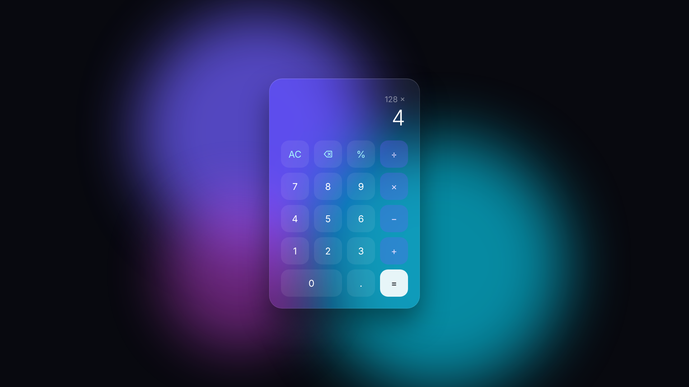

<div align="center">

# Glass Calculator

A calculator with a glassmorphism design, built from scratch with pure HTML, CSS and JavaScript.




</div>

## About

A minimal calculator focused on a clean, modern interface: a frosted glass panel floating over an animated gradient background. No frameworks, no libraries, just the fundamentals of the web.

## Features

- **Glassmorphism UI** with `backdrop-filter` blur and an animated gradient background
- **Basic operations**: addition, subtraction, multiplication, division and percentage
- **Chained calculations**: keep operating on the previous result
- **Delete** the last digit or **clear** everything
- **Division by zero** handled with an `Error` message
- **Number formatting** with thousands separators
- **Full keyboard support**

## Keyboard shortcuts

| Key | Action |
|---|---|
| `0` – `9` | Type a number |
| `.` | Decimal point |
| `+` `-` `*` `/` | Operators |
| `Enter` or `=` | Calculate |
| `Backspace` | Delete last digit |
| `Esc` | Clear |

## Project structure

```
glass-calculator/
├── index.html   # Layout and buttons
├── style.css    # Glass effect, animated background and button styles
└── script.js    # Calculator logic and keyboard support
```

## Getting started

No installation needed. Clone the repository and open `index.html` in your browser:

```bash
git clone https://github.com/moschettimarcos/glass-calculator.git
cd glass-calculator
```

## License

This project is licensed under the [MIT License](LICENSE).